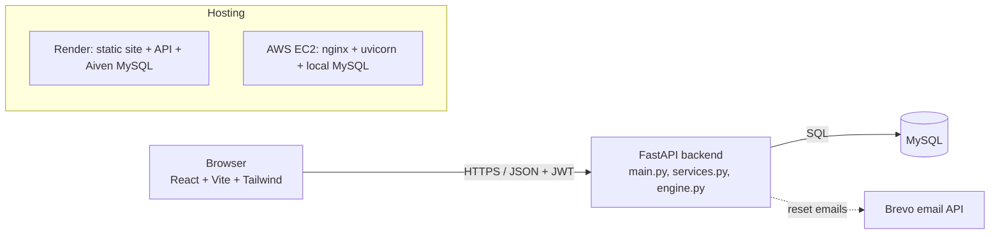

# LeetTrack: how it works

LeetTrack plans a daily DSA practice session: which old questions to revise today and which new
ones to start, based on a spaced-revision schedule and a daily capacity.

## Parts



| Part | Files | Job |
|---|---|---|
| Frontend | `frontend/src` | Pages (Dashboard, Questions, Progress, Profile, login screens) and small components |
| API routes | `backend/main.py` | Thin: check input, call a service, return JSON |
| Services | `backend/services.py` | The app's logic for each request |
| Engine | `backend/engine.py` | Revision dates, daily capacity, choosing new questions |
| Sheets | `backend/sheets.py`, `backend/sheets_data/` | Question sheets and how they are loaded into the database |
| Stats | `backend/stats.py` | Pure helpers for streaks, the activity grid and the calendar |
| Tests | `backend/tests` | Run without a database |

## Revision rules
- Daily capacity is 100 points. A new question costs 30 (Easy), 40 (Medium) or 55 (Hard).
- Each question is revised several times: Easy 2, Medium 4, Hard 5.
- The first revision comes after 7 (Easy), 5 (Medium) or 3 (Hard) days. After each revision the gap doubles.

## Question sheets
Each user chooses one sheet: Striver A2Z, Love Babbar 450, NeetCode 150 or the original Starter 200.
New questions are offered only from that sheet, in the sheet's order. Solved history is kept when
a user changes sheet.

Database tables added for this:

| Table | Purpose |
|---|---|
| `sheets` | One row per sheet (name, description, order) |
| `sheet_questions` | Which questions belong to which sheet, and in what order |
| `users.sheet_id` | The user's chosen sheet (empty = not chosen yet, treated as Starter 200) |

`backend/sheets.py` creates these tables and loads the sheet files when the API starts. It is safe to run
repeatedly, so deploying means pushing to GitHub.

### Where the question lists come from
- NeetCode 150: the public NeetCode 150 list, with LeetCode links.
- Striver A2Z: titles and difficulty from a public copy of the sheet (433 problems).
- Love Babbar 450: titles from a public copy of the sheet; difficulty labels are estimates. About 440 remain after removing duplicates.
- For Striver and Babbar, the "Open" link is a web search for the problem, not a direct link.

## Progress page
| Endpoint | Shows |
|---|---|
| `GET /api/me/topic-progress` | Solved / total for each topic of the chosen sheet |
| `GET /api/me/activity` | Last 12 weeks of activity, current and longest streak |
| `GET /api/me/calendar?month=YYYY-MM` | Revisions due on each day of a month, and how many are overdue |

Activity counts the day a question was solved plus the most recent revision day of each question.
The streak keeps going if you have not done anything yet today but did yesterday.

## Theme (light / dark)
- `<html data-theme="light|dark">` is set by `src/theme/theme.js` before the app draws.
- The choice is stored in `localStorage` key `leettrack-theme`; with no choice it follows `prefers-color-scheme`.
- `src/styles/theme.css` holds the palette as CSS variables (`--t-*` for login/landing, `--a-*` for in-app pages) and overrides for the Tailwind colour classes.
- `ThemeToggle` is the round button; `useTheme()` is the hook used by Profile > Appearance.
- To change a colour, edit the variables at the top of `theme.css` only.

## Run the tests
```
cd backend
python -m unittest discover -s tests -t .
```
